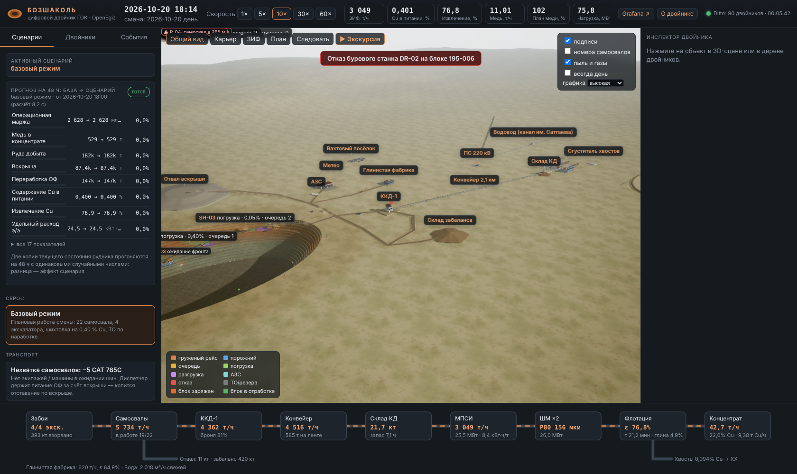

# team-082: цифровой двойник ГОК «Бозшаколь» на OpenEgiz

Медный ГОК **Бозшаколь** (KAZ Minerals, Павлодарская обл.) как связанная система из **113 двойников Eclipse Ditto**: два карьера (Центральный и Восточный) с планированием месяца по вскрытым запасам (вкладка «План месяца» в пульте: расстановка техники, прогноз на месяц и полгода, автоподбор плана), буровзрывные работы, 26 самосвалов, 6 экскаваторов и погрузчиков и диспетчеризация, обогатительная и глинистая фабрики, энергетика, ТОиР и промбезопасность. Двойники устроены как в платформе: 48 типов OpenTwins и плоское дерево, где вся техника — прямые дети ГОК (определения в [`bozshakol/twins/`](bozshakol/twins/)). В комплекте **3D-пульт диспетчера** со сменой дня и ночи и экскурсией по цепочке «забой → медь», **11 дашбордов Grafana**, **18 сценариев «что если»** с прогнозом на 48 часов **контроль качества по ГОСТ** (опробование и анализы — ГОСТ 14180, 13170, 24598; качество электроэнергии — ГОСТ 32144) и **ML на открытых данных конкурса** (геология блоков из скважин GeoMet, софтсенсор флотации, сейсмика; лицензии — [DATA_LICENSES.md](DATA_LICENSES.md)).



- Замысел, модули, сценарии, данные и допущения: [SUBMISSION.md](SUBMISSION.md)
- Презентация: [presentation.pdf](presentation.pdf)
- Устройство модели и разработка: [bozshakol/README.md](bozshakol/README.md)
- Платформа OpenEgiz (исходная документация): [OPENEGIZ.ru.md](OPENEGIZ.ru.md) / [OPENEGIZ.md](OPENEGIZ.md)

## Запуск с нуля (Ubuntu 24.04 + Docker)

Нужны Docker Engine с Compose v2, `git`, `python3` (есть в образе Ubuntu) и `make`. Из корня репозитория:

```bash
sudo apt-get update && sudo apt-get install -y make
make bozshakol
```

`make bozshakol` делает всё по шагам:

1. Генерирует пароли в `deploy/compose/.env`.
2. Поднимает платформу OpenEgiz (MongoDB, Eclipse Ditto, Mosquitto, Telegraf, InfluxDB, Grafana) и ждёт готовности Ditto.
3. Собирает образ модели (python:3.12-slim + paho-mqtt).
4. Загружает в Ditto 48 типов и 113 двойников из `bozshakol/twins/` и запускает модель рудника и 3D-пульт.
5. Ждёт, пока модель начнёт публиковать данные, и печатает адреса.

Первый запуск скачивает около 2,3 ГБ образов и занимает 10–20 минут; повторные запуски — около минуты. Нужно примерно 7 ГБ памяти для Docker.

Когда команда завершится, откройте:

| Что | Адрес | Доступ |
|---|---|---|
| **3D-пульт диспетчера** | http://localhost:8095/ | без входа |
| Grafana (обзор ГОК открывается первым) | http://localhost:3000/ | просмотр без входа; `admin` / пароль из вывода `make bozshakol` |
| Двойники в Ditto | http://localhost:8080/api/2/things/kz.bozshakol:site | `ditto` / пароль из вывода |
| Двойники в приложении OpenEgiz | Grafana → **OpenEgiz** → **Twins** → ГОК → **Children** (вся техника); **Types** — типы | войти как `admin` |
| Экскурсия по цепочке «забой → медь» | http://localhost:8095/?tour | без входа |

## Проверка стенда

```bash
make verify        # сквозная проверка: 113 двойников — дети ГОК, у каждого тип; модель идёт (MQTT → Ditto),
                   # история в InfluxDB (Ditto → Telegraf), 3D-пульт и прокси, сценарий туда-обратно
make twin-status   # текстовая сводка из Ditto: KPI, экскаваторы, тревоги, журнал, прогноз
make selftest      # балансы и пределы модели без Docker: бункеры, склад, деньги, металл, дизель, окно ГОСТ, места самосвалов
make calibrate     # модель против отчётов KAZ Minerals: 24 ч базы на 3 сидах против 2023 года и 6 кварталов (~30 с)
make plan-backtest # рекомендация «Подобрать план» на 10 новых наборах случайных событий (~5 мин на 8 ядрах)
```

## План месяца (главное решение двойника)

Откройте 3D-пульт → вкладка **«План месяца»** (первая):

1. Ползунками задайте расстановку: долю руды с Восточного карьера, CAT 785C на его руде, CAT 777D на его вскрыше, план вскрыши обоих карьеров, ТО по состоянию.
2. **«Посчитать месяц»** — через 20–40 секунд: руда и медь за месяц, медь за 6 месяцев с учётом вскрытых запасов и график запасов обоих карьеров по месяцам (текущий план — пунктиром).
3. **«Подобрать план»** — двойник проигрывает 8 расстановок по 48 ч и показывает таблицу; лучший вариант, выполняющий условия (≥ 1,5 мес вскрытой руды у каждого карьера, ≥ 97 % плана по руде), отмечен ★. На 8 ядрах — 1–2 минуты. Кнопка «Применить» переносит вариант в модель.

Без видеокарты пульт сам переходит в экономный режим графики.

## Сценарии «что если»

Сценарии запускаются без изменения кода. Каждый сценарий записывается в двойник `kz.bozshakol:control`, модель применяет его примерно за 3 секунды. Прогноз «база → сценарий» на 48 часов публикуется в двойник `kz.bozshakol:whatif` через 10–20 секунд.

Запустить сценарий можно тремя способами:

- в 3D-пульте, во вкладке **Сценарии**;
- из консоли:

  ```bash
  make scenario                      # список сценариев
  make scenario P=heavy_rain         # затяжной дождь: радар бортов, запреты, медленные дороги
  make scenario P=crusher_outage     # остановка ККД-1
make scenario P=harmonic_filter_off  # ФКУ отключена: гармоники вне норм ГОСТ 32144
  make scenario-reset                # отмена: базовый режим
  ```

- записью в Ditto напрямую, например:

  ```bash
  curl -u ditto:<пароль> -X PATCH -H 'Content-Type: application/merge-patch+json' \
    http://localhost:8080/api/2/things/kz.bozshakol:control \
    -d '{"features":{"trucks_parked":{"properties":{"value":5}}}}'
  ```

Полный перечень с ожидаемыми эффектами — в [SUBMISSION.md](SUBMISSION.md#сценарии-что-если).

## Управление

| Команда | Что делает |
|---|---|
| `make bozshakol` | Платформа и двойник Бозшаколь (повторный запуск безопасен) |
| `make down` / `make up` | Остановить или поднять всё, данные сохраняются |
| `make bozshakol-stop` | Остановить только модель; двойники и история остаются |
| `make logs S=bozshakol-twin` | Журнал модели |
| `make clean` | Удалить всё, включая данные и пароли |

## Если что-то пошло не так

| Симптом | Что сделать |
|---|---|
| `Ports already in use` | Освободите порт или поменяйте его в `deploy/compose/.env` (пульт: `BOZSHAKOL_UI_PORT`, по умолчанию 8095) и повторите `make bozshakol` |
| Пульт пишет «ждём двойников в Ditto» | Ditto ещё прогревается; через 1–2 минуты пульт подключится сам |
| Не видно истории в Grafana | Telegraf пишет раз в 10 секунд; подождите минуту или выполните `make verify` |

## Состав репозитория

| Путь | Что там |
|---|---|
| `bozshakol/` | Решение команды: модель рудника (`sim/`), двойники (`twins/`), 3D-пульт (`ui/`), дашборды (`grafana/`), ML (`ml/`), данные (`data/`), инструменты (`tools/`), документы (`docs/`). Подробно — [bozshakol/README.md](bozshakol/README.md) |
| `SUBMISSION.md` | Описание решения: Замысел, двойники, модули и сценарии, данные и допущения, ограничения |
| `presentation.pdf` | Презентация |
| `DATA_LICENSES.md` | Лицензии и атрибуция всех наборов данных |
| `AGENTS.md`, `CLAUDE.md` | Инструкции организатора для ИИ-агентов |
| `team/` | Каталог шаблона для кода команды; наше решение лежит в `bozshakol/` |
| `examples/mine/` | Пример рудника из шаблона; решением не является и не используется |
| `OPENEGIZ.md`, `OPENEGIZ.ru.md` | Документация платформы OpenEgiz v1.0.4 |

Оценивается ветка `main` на момент заморозки.

## Лицензия

Решение распространяется по [MIT](LICENSE); авторские права — у команды (строка Copyright в `LICENSE`). OpenEgiz и его компоненты распространяются по своим лицензиям ([NOTICE](NOTICE)). Three.js (`bozshakol/ui/vendor/three`) — MIT, лицензия приложена.
